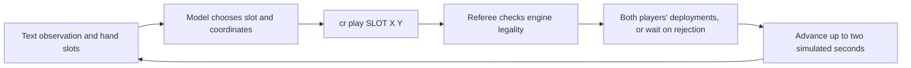

# Coordinate-action harness

[RoyaleBench v3](royalebench_v3.md) promoted this protocol to all 11 released scenarios.
The current default is [RoyaleBench v9](royalebench_v9.md). This page preserves the historical three-task pilot and its results.

The **RoyaleBench coordinates pilot** is a separate Harbor dataset at
[`benchmarks/royalebench-coordinates`](../benchmarks/royalebench-coordinates), version
`1.0.0-coordinate.1`, action mode `coordinates-v1`. It uses three frozen v1 positions:
immediate lethal, spell placement, and cycle to lethal. It changes player action selection,
not the initial state, opponent configuration, or scenario objectives. The existing v1 task
snapshots and reference evidence remain unchanged. The pilot is published as
`royalebench/royalebench-coordinates@1`. Local reference validation passes and the six-attempt
Sonnet 4.6 pilot is complete, with run IDs and evidence recorded in
[`checks.json`](../runs/royalebench-coordinates/checks.json).

## Player flow



- `cr`: observe the current board, exact HP/positions, ordinary visible events, and hand slots.
- `cr play SLOT X Y`: play hand slot **0–3** at own-frame tile coordinates.
- `cr wait`: wait one decision interval. `cr act N` is unavailable in this mode.
- Coordinates satisfy `0 <= x < 18`, `0 <= y < 32`. They are converted to the nearest engine
  subtile; there is no search or snapping to a nearby legal placement. Engine deployment rules
  are authoritative. The normal text view and card costs remain available; target suggestions,
  numbered moves and placement masks are not exposed.
- A well-formed but illegal play (invalid slot, empty slot, outside arena, insufficient elixir,
  illegal position, or a scenario-unavailable card) becomes a wait for that interval. It costs
  no elixir and reports the rejection. A malformed command is rejected without advancing time.
- The game pauses during thinking. Each submitted decision advances at most 40 ticks / two seconds.
  Unlike the menu interface, empty/unaffordable hands still receive decisions where the player
  can wait. The scenario's explicit decision limit or completed single-spell allowance resolves
  remaining waits automatically.
- Spending/lane limits are disclosed scoring constraints. The harness permits overspending;
  the verifier applies the same limits to accepted plays. Explicit card availability and
  decision-count restrictions still apply.
- A chat answer or incomplete sequence scores zero. The existing instruction to submit each
  decision personally, without a program or loop, remains an instruction-level restriction.

Planner uses its existing coordinate candidate generator, full engine information and search
settings. It chooses from the same frozen state as the player before either deployment applies.
Both use the engine's coordinate deployment primitive; Planner's candidate selection is not
restricted to a player menu. Its hidden-information advantage remains disclosed. The menu-based
`PlannerPlayer` wrapper used elsewhere is unchanged.

## Logging and replay

The protected action log records the submitted action, decision and tick, application tick,
state/action hashes, acceptance, rejection reason, and accepted deployment in engine subtiles. The server
flushes each entry before applying it. A restarted server reconstructs the scenario from those
entries. The separate verifier repeats schema/legality checks and compares every required
recorded field before applying an action. Coordinate changes, altered acceptance metadata,
missing hashes, inconsistent ticks, malformed logs and extra actions fail integrity.

Invalid deployments are recorded as `rejected_action`, with a `coordinate_attempt` telemetry
event containing their requested coordinates. Analysis counts them as error waits, not voluntary
waits. Response timing starts at the first observation and is not reset by repeated observation;
an action before any observation has unknown timing. Timing remains diagnostic, not a score.

## Build and validate

```bash
uv run python -m cr_arena.coordinate_benchmark
uv run --with pytest python -m pytest -q tests/test_coordinate_task.py tests/test_royalebench_v1.py tests/test_royale_task.py tests/test_telemetry.py
uv run python -m cr_arena.validate_v1_docker --benchmark benchmarks/royalebench-coordinates
```

The builder converts frozen v1 reference moves to their actual stored coordinates, including
any placement snapping that already happened when v1 generated its menu. It inserts explicit
wait decisions where necessary, then verifies the coordinate log twice and checks wait, empty
and malformed negative controls before packaging. These are oracle references, not model runs.
It refuses to overwrite the frozen v1 dataset. Reference/config/protocol hashes and local evidence
live under [`runs/royalebench-coordinates`](../runs/royalebench-coordinates).

Docker validation builds the packaged runtime, runs the protected coordinate reference through
the actual `cr` client as `player`, checks private-file/root isolation, restarts the server,
and grades the carried action log in a fresh container with no networking. Full
captures are generated under `runs/royalebench-coordinates/docker`; see the
[artifact policy](../runs/README.md).

## Model comparison

On November 14, 2026, `anthropic/claude-sonnet-4-6` through `claude_code-v1.0.0` on Modal
completed one attempt per task and interface. All six attempts finished with integrity 1.
The underlying Claude Code CLI was `2.1.325` in every attempt. Both modes used one CPU,
2048 MB memory, 4096 MB storage, a 3600-second agent timeout, concurrency 1 per run, and
the same model/harness defaults with no sampling overrides. Effective inference settings
were not independently measured. Total reported model API cost was **$0.96029**, excluding Modal.

| Task | Frozen v1 menu | Coordinates |
| --- | --- | --- |
| Immediate lethal | 1 | 1 |
| Spell placement | 1 | 1 |
| Cycle to lethal | 0 | 1 |
| Solved | 2/3 | 3/3 |

This is a small functional pilot, not a reliable estimate of relative difficulty or a causal
effect of the interface. It does not support claiming coordinate mode is harder.

The menu cycling failure was completed play, not an infrastructure/integrity error: the model
played IceSpirits, Skeletons, then Fireball. Its own tower fell at elapsed 5.9 seconds before the
offensive spell resolved. The validated menu reference uses Cannon on its second play. The
coordinate model instead won with IceSpirits at `(3.5, 13)`, IceGolemite at `(3.5, 9)`, then
Fireball at `(3.5, 25.5)`, spending 7 elixir and taking 253 damage. It made no rejected deployments.
The coordinate spell-placement attempt chose `(3.5, 12)` and took 107 damage against the 150 limit.

Exact actions, prompt/log hashes, per-attempt costs, settings and outcomes are in
[`model-pilot.json`](../runs/royalebench-coordinates/model-pilot.json). Raw service result files
are adjacent. The runs were:

- Coordinate lethal: `d9d59d13-2e91-414e-a1db-bf1f1374b308` on `royalebench/royalebench-coordinates@1`.
- Coordinate placement/cycle: `a7b01653-ea26-48f5-9a18-93abdbcfac35` on the same revision.
- Matching menu tasks: `8bbde46b-27eb-4156-a7d0-c8a75e6f7b04` on frozen `royalebench/royalebench-v1@1`.

All runs were enrolled in evidence collection and copied to the durable archive. Coordinate
captures are complete. The frozen menu runtime predates telemetry identities and online full-replay
capture; the collector accurately reports those gaps. Its model action logs were separately
replayed in fresh offline containers built from the frozen v1 sources, reproducing both successes
and the cycling loss with matching frame hashes. The reconstructed replays are
generated under `runs/royalebench-coordinates/menu-model-replays`; they are not
original online telemetry and are not part of the compact submission evidence.

Use the immutable published revision through the existing
[Valkyrie/Modal workflow](valkyrie_guide.md). Run one task first, inspect its trace, then compare
the three coordinate tasks with the matching v1 menu tasks using the same model, harness,
resources, and sampling settings. Keep per-mode rewards, rejection counts, cost, completion,
and failure classifications separate. Larger action space can help as well as hurt performance.
Do not claim greater difficulty until further model runs support it. The hosted model/API path
has been exercised; phase-specific network-policy enforcement has not been independently probed.

Sources: [`coordinate_task.py`](../cr_arena/coordinate_task.py) owns the protocol;
[`coordinate_benchmark.py`](../cr_arena/coordinate_benchmark.py) owns conversion, calibration and
packaging. Regenerate the pilot after changes; never patch packaged tasks directly.
