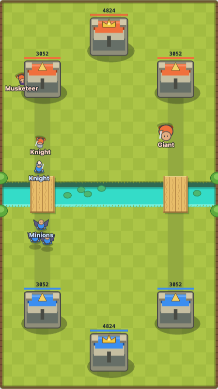
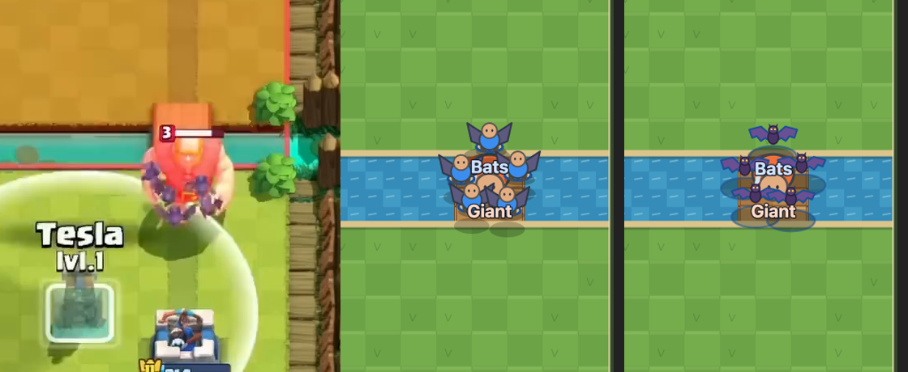

# Battle graphics

Live play and saved HTML replays use `cr_arena/battle_renderer.js` for the arena,
units, names, health bars, projectiles, spells, and animation effects. Change those
graphics there so both views stay consistent. The renderer takes positions and
radii in tiles, with Blue at the bottom; its file header documents the row layout.
Both views supply the arena grid from the simulation or trace, rather than
guessing bridge positions.

The arena now uses layered grass, water, stone banks, and wooden bridge planks.
Bridges and rails follow the simulator's actual water grid. Towers and troops
are original canvas miniatures with team-colored roofs or bases, so replay files
remain self-contained and work offline. The troop silhouettes cover the common
RoyaleGym cards; an unknown card receives a generic armored miniature and its
name label. These are illustrative graphics, not imported Clash Royale assets.
REA 6.9.0 parsed `battle_renderer.js` as a standalone JavaScript source and
found no module imports in that file; it did not evaluate the artwork. The
graphics were then checked in a browser against a recorded replay. REA is an
analysis tool and is not needed at runtime.



The [Arena 1 gameplay video](https://www.youtube.com/watch?v=PD6QCK7GzA8)
is saved locally at `data/references/arena-1-PD6QCK7GzA8.mp4` for a future
reference-matching pass; see [data documentation](../data/README.md#visual-reference).

## Flying units

The flyers in `CLASSIC_DECKS` (Baby Dragon, Balloon, Bats, Lava Hound, Mega Minion
and Minions, plus Lava Pups spawned by a Lava Hound) have their own miniatures and
elevation. Each unit's `flying_height` comes from RoyaleAPI's
[`cards_stats.json`](https://royaleapi.github.io/cr-api-data/json/cards_stats.json):
1.5 tiles for Minions and Mega Minion, 2 for Bats, 3 for Balloon, 3.5 for Baby Dragon
and Lava Pups, and 4 for Lava Hound. The body is drawn 0.3 screen tiles above the
ground per tile of height, with a slight hover. Its shadow and a thin team ring stay
on the interpolated ground position and are drawn before all ground units. Flyers
are drawn after every ground unit and tower, far before near, so their hit targets,
health bars and labels follow the raised body. Other flying cards keep the generic
half-tile lift.

The engine gives Lava Pups the Lava Hound card id, so the renderer identifies them by
radius (0.45 vs 0.75 tiles), or by health in traces without radii, and labels them
"Lava Pups". REA 6.9.0 traced the `flying` flag through `battle_renderer.js` before
this change. It showed that the flag affected only a fixed half-tile body offset and
a shadow drawn during the depth-sorted entity pass. On macOS 27, REA's helper needs
`SDKROOT` set to the 26.5 Command Line Tools SDK.

The Arena 1 reference video shows only Bats among these flyers. Its frames at 8:14–8:17
(Bats over a Giant at the right bridge) confirm that flyers are drawn over ground
troops, with shadows on the ground below. The miniatures for the other flyers are
original designs informed by the card heights above.




`live.html` handles the WebSocket stream, HUD, and placement controls. `replay.html`
adapts RoyaleGym's named trace columns into the same drawing contract and handles
playback, scrubbing, flipping, and tooltips. Its playback controls were adapted
from RoyaleGym under the MIT license in `third_party/RoyaleGym-LICENSE.txt`.
`replay.py` continues using RoyaleGym to validate and prepare traces, but no longer
patches upstream JavaScript strings.

`rendering.embed_renderer` embeds the shared JavaScript in both pages. Generated
replays remain single HTML files that work offline. Existing generated HTML files
need to be re-rendered to pick up graphics changes:

```sh
uv run python -m cr_arena.replay path/to/battle.msgpack -o battle.html
uv run python -m unittest discover -s tests
node --test tests/battle_renderer.test.cjs
```

Live input previews and replay deploy annotations are view-specific overlays.
Live placement masks use RoyaleGym's `PlacementOracle` at half-tile resolution,
independent of elixir and the opening lockout. Each mask carries its dimensions,
resolution, and card ID. The same half-cell defines its shading and the centre
sent on a click, and stale masks for a different card are ignored. Spatially
eligible cells can still require more elixir or waiting before a play is accepted.
Living friendly princess towers exclude their engine-reported placement footprints
for troop and building drops; spells can still target them. Their shared graphics
use those same footprints, and destroyed towers release the occupied area. King
towers retain their arena-defined exclusion block.
Replay interpolation is a straight-line estimate between recorded frames; a
replay cannot recover live events or pending placements absent from its trace.
