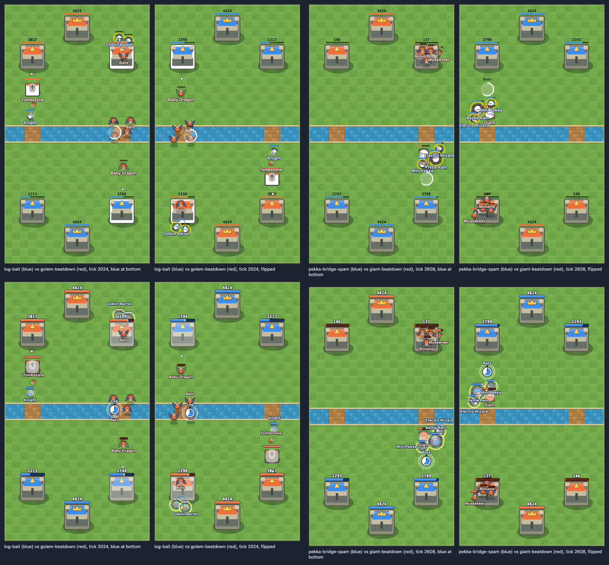
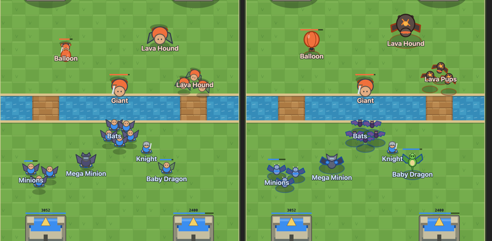

# Battle graphics

Live play and saved HTML replays use `cr_arena/battle_renderer.js` for the arena,
units, names, health bars, projectiles, spells, and animation effects. Change those
graphics there so both views stay consistent. The renderer takes positions and
radii in tiles, with Blue at the bottom; its file header documents the row layout.
Both views supply the arena grid from the simulation or trace, rather than
guessing bridge positions.

The terrain follows Arena 1: a two-tone grass checker, worn lanes from each
bridge towards the princess towers, a turquoise river with a shaded upper bank
and lily pads, plank bridges that reach half a tile onto each bank, and a wooden
palisade border with bushes at the river ends. `drawGround` derives the water
cells and bridge decks from the simulator grid, so the decks, their rails, and
the lanes follow the actual walkable bridge cells in either board orientation.
This pass covers Arena 1 only and is shared by the seven classic decks in
`cr_arena/decks.py`; there are no alternate arena skins. Towers and troops are
original canvas miniatures with team-colored roofs or bases, so replay files
remain self-contained and work offline. These are illustrative graphics, not
imported Clash Royale assets.


### Arena 1 terrain reference check

Terrain colours were sampled from the
[Arena 1 gameplay video](https://www.youtube.com/watch?v=PD6QCK7GzA8), saved
locally at `data/references/arena-1-PD6QCK7GzA8.mp4` (see
[data documentation](../data/README.md#visual-reference)). REA does not read
MP4 frames, so frames were taken with ffmpeg at 0:20, 0:45, 1:10, 1:40, 2:10
and 2:40, for example:

```sh
ffmpeg -ss 00:01:40 -i data/references/arena-1-PD6QCK7GzA8.mp4 -frames:v 1 -vf "crop=960:1080:960:0" ref.png
```

The 1:40 frame shows the arena without a placement overlay and was averaged
over 7×7-pixel patches for grass, lanes, water, the bank shadow, lily pads,
bridge planks, and the border. Palette values in `battle_renderer.js` are those
samples, toned down slightly because the video is saturated by compression.

The comparison below shows, from left to right, the previous terrain, the new
terrain, the new terrain with Red at the bottom, and the 1:40 reference frame.
The first three are the same replay frame (tick 400, 0:20.0) of
`runs/samples/heuristic-bot__vs__claude-fable-5.1__s2.msgpack`. The geometry is
the simulator's, not the video's: the simulated river is wider relative to the
field than the reference river is.


REA 6.9.0 (`npx rea-agents analyze-javascript-application`) was run on a copy of
the previous `battle_renderer.js`. It inventoried the file and recorded its
SHA-256 (`3dfdb5f2…5dbe10`, matching the file before this change), but source
parsing failed at startup on macOS: its process-ownership helper did not
compile against the installed Command Line Tools SDK (`MacOSX27.0.sdk`). It
reported every semantic graph family (call flow, data flow, closures, and
others) as partial, with zero retained relations. Its follow-up commands,
such as `trace-javascript-semantics`, need evidence from a successful analysis,
so they were not run. The terrain drawing path was therefore traced by reading
the source: `draw` calls `drawGround` first, which used only `arena.grid`,
`arena.half`, `arena.water_half_rows`, and `arena.bits.WATER`, and did not read
entity state. REA is an analysis tool and is not needed at runtime.

## Battle indicators

Indicators cover what appears in matches between the seven classic decks: health
and shield bars, troop names, units still deploying, your pending plays, hit
feedback, and stuns such as those from Zap and Electro Wizard. They follow the
reference video's conventions, such as outlined bars, white tower numbers and a
stopwatch for a waiting play, while keeping this project's own graphics.

- Bars have a dark outline over a dark team-colored track. Health lost in the last
  0.7 s shows as a fading pale segment. Bars draw after every miniature, so a crowd
  never hides them. Tower bars and white outlined tower numbers draw last.
- A hit briefly lightens the unit or the tower footprint instead of turning it
  solid white, so its team color stays visible.
- A stunned unit has a jagged electric ring, and a yellow arc that drains as the
  stun wears off. The full length is the stun's largest value since it began.
- A deploying unit has a turning dashed ring in its team color.
- A pending play is a stopwatch at its landing spot. The blue wedge is the delay
  left, and the card name sits above it.
- Troop names start below their unit. A name that would cover a bar, a tower
  number, a spell or pending label, or another name moves above or beside its
  unit. If every spot is taken, it may cross a bar but never other text. Newer
  units get first choice.

Indicator state is derived from consecutive snapshots in `observe`, and `reset`
clears it, so seeking reproduces the same frame. Drawing never alters snapshots,
and hit targets keep the same positions and radii. Entity art, terrain, spells
and the HUD are unchanged.



Matched screenshots come from real classic-deck games. Each deck plays the next
deck in the list with the live command delay, and the busiest frame is kept,
favoring stuns and pending plays:

```sh
uv run python -m tests.visual.capture_scenes runs/indicator_scenes.json
uv run python -m http.server 8791 --bind 127.0.0.1   # from the repository root
git show HEAD:cr_arena/battle_renderer.js > runs/indicator_check/baseline_renderer.js
NODE_PATH=/path/to/node_modules node tests/visual/screenshot_scenes.cjs http://127.0.0.1:8791 \
  runs/indicator_check/before /runs/indicator_check/baseline_renderer.js
NODE_PATH=/path/to/node_modules node tests/visual/screenshot_scenes.cjs http://127.0.0.1:8791 \
  runs/indicator_check/after
cmp runs/indicator_check/before/hits.json runs/indicator_check/after/hits.json
```

The screenshot script needs the `playwright` npm package with Chromium installed.
`hits.json` records every hit target in both orientations, so `cmp` shows whether
a change moved any target.

The indicator paths were traced with REA 6.9.0
(`analyze-javascript-application` on a copy of the renderer). It reported
`draw → drawEntity → hpBar/shieldBar`, the stun and deploy rings, the label and
pending-play loops in `draw`, and hit timing from `observe` into `drawFx`. On
macOS with Command Line Tools for Swift 6.3, REA's process helper fails to build
against the macOS 27 SDK. Set
`SDKROOT=/Library/Developer/CommandLineTools/SDKs/MacOSX26.5.sdk` for the run.
## Flying units

The flyers in `CLASSIC_DECKS` (Baby Dragon, Balloon, Bats, Lava Hound, Mega Minion
and Minions, plus Lava Pups spawned by a Lava Hound) have their own miniatures and
elevation. Each unit's `flying_height` comes from RoyaleAPI's
[`cards_stats.json`](https://royaleapi.github.io/cr-api-data/json/cards_stats.json):
1.5 tiles for Minions and Mega Minion, 2 for Bats, 3 for Balloon, 3.5 for Baby Dragon
and Lava Pups, and 4 for Lava Hound. The body is drawn 0.3 screen tiles above the
ground per tile of height, with a slight hover. Its shadow and a thin team ring stay
on the interpolated ground position and are drawn before all ground units. Flyers
are drawn after every ground unit and tower, far before near, so their hit targets,
health bars and labels follow the raised body. Other flying cards keep the generic
half-tile lift.

The engine gives Lava Pups the Lava Hound card id, so the renderer identifies them by
radius (0.45 vs 0.75 tiles), or by health in traces without radii, and labels them
"Lava Pups". REA 6.9.0 traced the `flying` flag through `battle_renderer.js` before
this change. It showed that the flag affected only a fixed half-tile body offset and
a shadow drawn during the depth-sorted entity pass. On macOS 27, REA's helper needs
`SDKROOT` set to the 26.5 Command Line Tools SDK.

The Arena 1 reference video shows only Bats among these flyers. Its frames at 8:14–8:17
(Bats over a Giant at the right bridge) confirm that flyers are drawn over ground
troops, with shadows on the ground below. The miniatures for the other flyers are
original designs informed by the card heights above.




## Classic-deck ground troops

The ground troops of the seven classic decks (Archer, Battle Ram, Electro Wizard,
Giant, Goblin Gang, Golem, Hog Rider, Ice Golem, Ice Spirits, Knight, Mini P.E.K.K.A,
Musketeer, P.E.K.K.A, Princess, Skeletons and Wizard) and the units they spawn in
classic-deck traces (Golemites, Barbarians, stab Goblins, Spear Goblins and
individual Skeletons) use upright three-quarter miniatures. Team colour is on
each base and on a cape, tabard, sash or belt. A troop no longer spins with its
facing. It mirrors when moving left on screen and shows its back when walking up
the screen. The pose uses the same screen-space facing as before, so board
flipping still applies. Entity position, interpolation, radius, health bars and
hit targets are unchanged. Flying troops, buildings, towers, spells and every other card
keep their earlier drawing.


A spawned unit keeps its card's ID: a Golemite reports the Golem card, a Barbarian
the Battle Ram, and a Spear Goblin Goblin Gang. Entity rows therefore carry an
optional 19th field, `unitType`, holding the engine's unit-type name
(`Engine.unit_types()` live; `TraceHeader.unit_types` in replays). The renderer
uses it only for the cards above, so Tombstone and Goblin Barrel units are
unchanged. Traces without unit types fall back to the card, with units narrower
than 0.62 tiles drawn as Golemites or Barbarians.

REA 6.9.0 (`analyze-javascript-application`, then `trace-application-feature`
and `trace-javascript-semantics`) traced the path before the change. `drawTroop` had one caller,
`drawEntity`, whose `facing` argument came from `facingX/facingY` after the
flip transform. Card identity came from the `cards` binding set in `draw` and
read as `cards[cid][0]`, then classified by regular expressions. That is why
Golemites drew as Golem-coloured humans and Barbarians as Battle Ram tokens.
On macOS 27, REA's process helper builds only with an older SDK:
`SDKROOT=/Library/Developer/CommandLineTools/SDKs/MacOSX26.5.sdk`.

Visual references: the local Arena 1 video at 1:16, 3:00 and 3:36 shows upright
P.E.K.K.A, Archers with team-coloured capes and level badges, and units that turn
by mirroring. Troops absent from that video were checked against their card pages
on the [Clash Royale Wiki](https://clashroyale.fandom.com/wiki/Cards):
[Giant](https://clashroyale.fandom.com/wiki/Giant),
[Hog Rider](https://clashroyale.fandom.com/wiki/Hog_Rider),
[Golem](https://clashroyale.fandom.com/wiki/Golem),
[Ice Golem](https://clashroyale.fandom.com/wiki/Ice_Golem),
[Ice Spirit](https://clashroyale.fandom.com/wiki/Ice_Spirit),
[Electro Wizard](https://clashroyale.fandom.com/wiki/Electro_Wizard),
[Wizard](https://clashroyale.fandom.com/wiki/Wizard),
[Princess](https://clashroyale.fandom.com/wiki/Princess),
[Battle Ram](https://clashroyale.fandom.com/wiki/Battle_Ram),
[Knight](https://clashroyale.fandom.com/wiki/Knight),
[Musketeer](https://clashroyale.fandom.com/wiki/Musketeer),
[Mini P.E.K.K.A](https://clashroyale.fandom.com/wiki/Mini_P.E.K.K.A),
[Goblin Gang](https://clashroyale.fandom.com/wiki/Goblin_Gang) and
[Skeletons](https://clashroyale.fandom.com/wiki/Skeletons). The miniatures keep
only identifying traits, such as hair colour, headgear and weapon. They remain original canvas
drawings.

`live.html` handles the WebSocket stream, HUD, and placement controls. `replay.html`
adapts RoyaleGym's named trace columns into the same drawing contract and handles
playback, scrubbing, flipping, and tooltips. Its playback controls were adapted
from RoyaleGym under the MIT license in `third_party/RoyaleGym-LICENSE.txt`.
`replay.py` continues using RoyaleGym to validate and prepare traces, but no longer
patches upstream JavaScript strings.

`rendering.embed_renderer` embeds the shared JavaScript in both pages. Generated
replays remain single HTML files that work offline. Existing generated HTML files
need to be re-rendered to pick up graphics changes:

```sh
uv run python -m cr_arena.replay path/to/battle.msgpack -o battle.html
uv run python -m unittest discover -s tests
node --test tests/battle_renderer.test.cjs
```

Live input previews and replay deploy annotations are view-specific overlays.
Live placement masks use RoyaleGym's `PlacementOracle` at half-tile resolution,
independent of elixir and the opening lockout. Each mask carries its dimensions,
resolution, and card ID. The same half-cell defines its shading and the centre
sent on a click, and stale masks for a different card are ignored. Spatially
eligible cells can still require more elixir or waiting before a play is accepted.
Living friendly princess towers exclude their engine-reported placement footprints
for troop and building drops; spells can still target them. Their shared graphics
use those same footprints, and destroyed towers release the occupied area. King
towers retain their arena-defined exclusion block.
Replay interpolation is a straight-line estimate between recorded frames; a
replay cannot recover live events or pending placements absent from its trace.

## Live HUD and placement cues

The live HUD follows the layout of the Arena 1 reference video while keeping the
original artwork. A timer box shows "Time left", "Overtime", or "Paused", and a
badge appears when elixir runs at x2 or x3. Each side has a crown badge. The hand
tray shows a "Next:" preview card, four portrait cards with the elixir cost in a drop
at the bottom, and a ten-segment elixir bar with the whole-elixir count beneath them.
Hand art is defined only for the 35 distinct cards in the seven `CLASSIC_DECKS`.
Other cards fall back to the shared unit icon. The cards, next card, timer, crowns,
and elixir meter have accessible labels.

`placement.draw` still shades each blocked half-cell. It also outlines the boundary
between blocked and allowed cells, then previews the selected card at the hovered
half-cell centre, which is the point sent on a play:

- Troops show a ring and the snapped half-cell.
- Buildings show their engine `footprint_tiles` square, sent as the fourth field of
  each `init` card. Cannon, Inferno Tower, Tombstone, and X-Bow use 3 tiles; Tesla
  uses 2.
- Spells show their area. The engine does not report spell areas, so these radii are
  display-only approximations: Fireball and Zap 2.5, Arrows 4, Rocket 2, Lightning
  and Poison 3.5, and Goblin Barrel 1.5. The Log shows a 3.9-tile-wide lane that
  rolls forward. Legality always comes from the mask.

The preview's name label turns red and adds "not here" over a blocked cell. Phone
screenshots at 390×844, taken before and after this change, are in
[`images/hud/`](images/hud/).

REA 6.9.0 static analysis (`rea-agents analyze-javascript-application`) of
`battle_renderer.js` and the live page's inline script found one `WebSocket`
request, one `JSON.parse` boundary for incoming messages, and one timer, used by
the toast. On macOS with the 27.0 Command Line Tools SDK, REA's Swift helper fails
to compile. Run REA with `SDKROOT` set to the 26.5 SDK instead.
