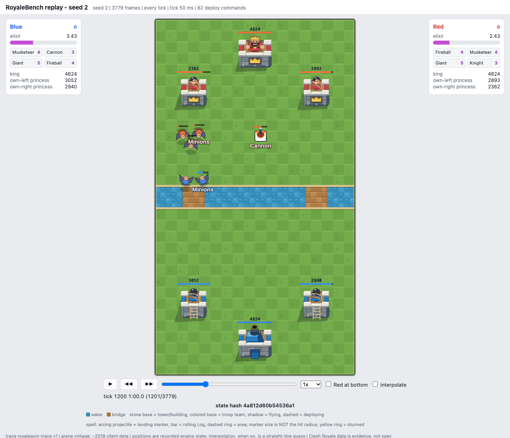
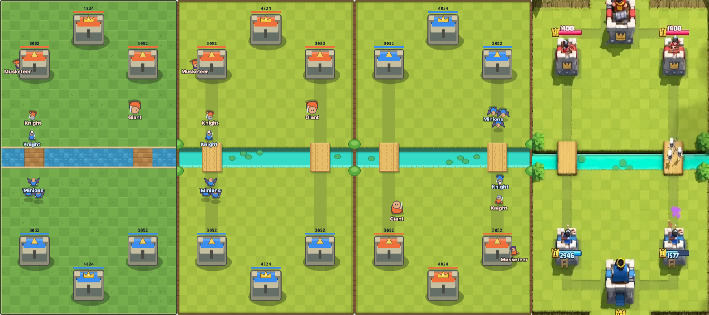
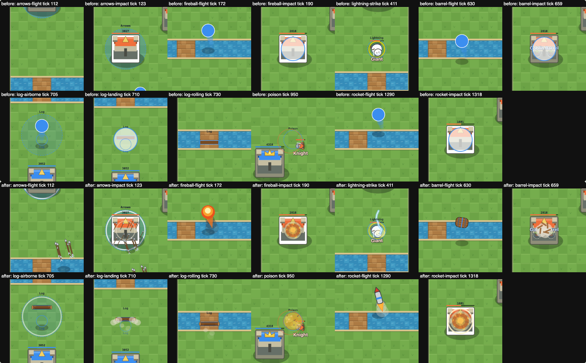
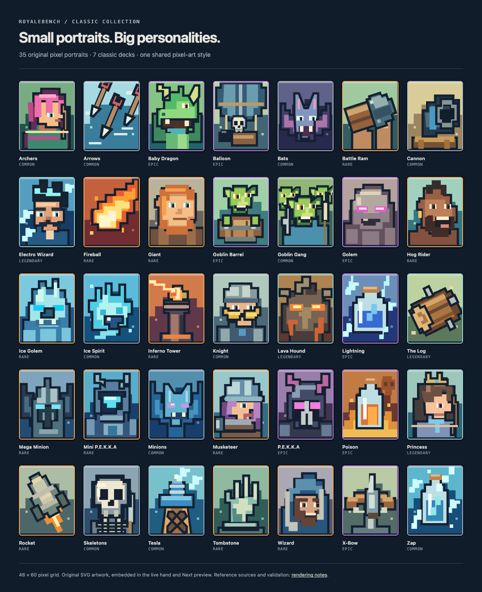
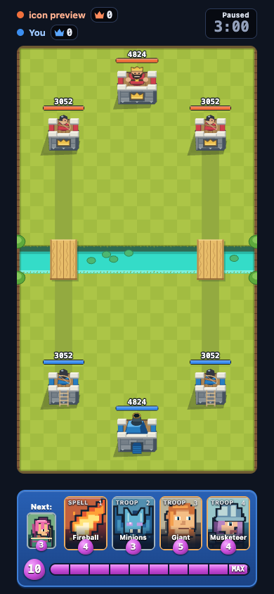
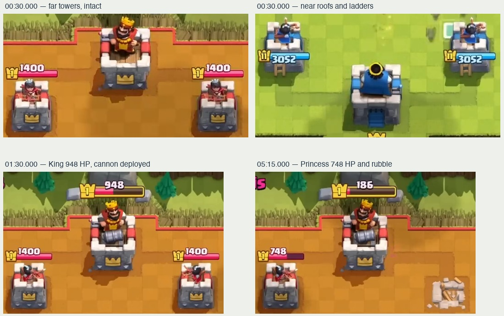
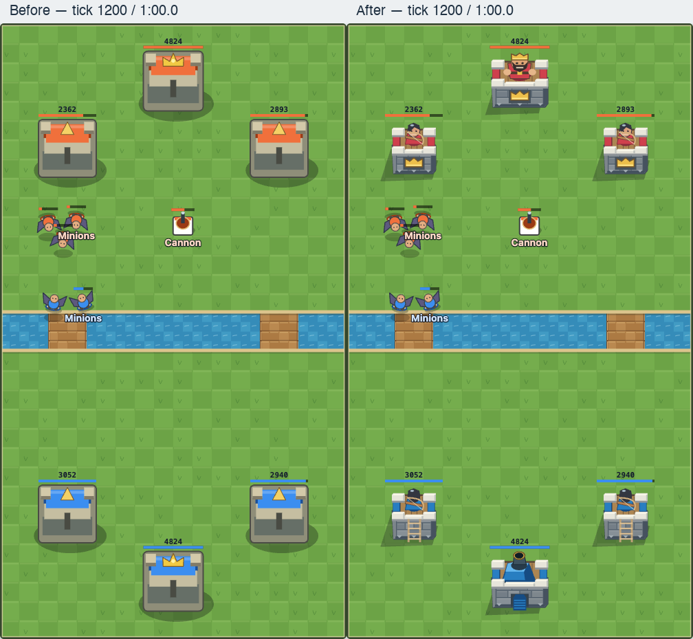

# Battle graphics

Live play and saved HTML replays use `cr_arena/battle_renderer.js` for the arena,
units, names, health bars, projectiles, spells, and animation effects. Change those
graphics there so both views stay consistent. The renderer takes positions and
radii in tiles, with Blue at the bottom; its file header documents the row layout.
Both views supply the arena grid from the simulation or trace, rather than
guessing bridge positions.

The terrain follows Arena 1: a two-tone grass checker, worn lanes from each
bridge towards the princess towers, a turquoise river with a shaded upper bank
and lily pads, plank bridges that reach half a tile onto each bank, and a wooden
palisade border with bushes at the river ends. `drawGround` derives the water
cells and bridge decks from the simulator grid, so the decks, their rails, and
the lanes follow the actual walkable bridge cells in either board orientation.
This pass covers Arena 1 only and is shared by the seven classic decks in
`cr_arena/decks.py`; there are no alternate arena skins. Towers and troops are
original canvas miniatures with team-colored roofs or bases, so replay files
remain self-contained and work offline. These are illustrative graphics, not
imported Clash Royale assets.

The King and Princess Tower artwork was refined against timestamped frames from
the local gameplay reference. [REA](https://github.com/morluto/rea) inspected the
JavaScript drawing path; ffmpeg extracted the video frames and those images were
inspected visually. REA did **not** analyze the video or judge visual similarity.
REA is an analysis tool and is not needed at runtime.



### Arena 1 terrain reference check

Terrain colours were sampled from the
[Arena 1 gameplay video](https://www.youtube.com/watch?v=PD6QCK7GzA8), saved
locally at `data/references/arena-1-PD6QCK7GzA8.mp4` (see
[data documentation](../data/README.md#visual-reference)). REA does not read
MP4 frames, so frames were taken with ffmpeg at 0:20, 0:45, 1:10, 1:40, 2:10
and 2:40, for example:

```sh
ffmpeg -ss 00:01:40 -i data/references/arena-1-PD6QCK7GzA8.mp4 -frames:v 1 -vf "crop=960:1080:960:0" ref.png
```

The 1:40 frame shows the arena without a placement overlay and was averaged
over 7×7-pixel patches for grass, lanes, water, the bank shadow, lily pads,
bridge planks, and the border. Palette values in `battle_renderer.js` are those
samples, toned down slightly because the video is saturated by compression.

The comparison below shows, from left to right, the previous terrain, the new
terrain, the new terrain with Red at the bottom, and the 1:40 reference frame.
The first three are the same replay frame (tick 400, 0:20.0) of
`runs/samples/heuristic-bot__vs__claude-fable-5.1__s2.msgpack`. The geometry is
the simulator's, not the video's: the simulated river is wider relative to the
field than the reference river is.



REA 6.9.0 (`npx rea-agents analyze-javascript-application`) was run on a copy of
the previous `battle_renderer.js`. It inventoried the file and recorded its
SHA-256 (`3dfdb5f2…5dbe10`, matching the file before this change), but source
parsing failed at startup on macOS: its process-ownership helper did not
compile against the installed Command Line Tools SDK (`MacOSX27.0.sdk`). It
reported every semantic graph family (call flow, data flow, closures, and
others) as partial, with zero retained relations. Its follow-up commands,
such as `trace-javascript-semantics`, need evidence from a successful analysis,
so they were not run. The terrain drawing path was therefore traced by reading
the source: `draw` calls `drawGround` first, which used only `arena.grid`,
`arena.half`, `arena.water_half_rows`, and `arena.bits.WATER`, and did not read
entity state. REA is an analysis tool and is not needed at runtime.

## Battle indicators

Indicators cover what appears in matches between the seven classic decks: health
and shield bars, troop names, units still deploying, your pending plays, hit
feedback, and stuns such as those from Zap and Electro Wizard. They follow the
reference video's conventions, such as outlined bars, white tower numbers and a
stopwatch for a waiting play, while keeping this project's own graphics.

- Bars have a dark outline over a dark team-colored track. Health lost in the last
  0.7 s shows as a fading pale segment. Bars draw after every miniature, so a crowd
  never hides them. Tower bars and white outlined tower numbers draw last.
- A hit briefly lightens the unit or the tower footprint instead of turning it
  solid white, so its team color stays visible.
- A stunned unit has a jagged electric ring, and a yellow arc that drains as the
  stun wears off. The full length is the stun's largest value since it began.
- A deploying unit has a turning dashed ring in its team color.
- A pending play is a stopwatch at its landing spot. The blue wedge is the delay
  left, and the card name sits above it.
- Troop names start below their unit. A name that would cover a bar, a tower
  number, a spell or pending label, or another name moves above or beside its
  unit. If every spot is taken, it may cross a bar but never other text. Newer
  units get first choice.

Indicator state is derived from consecutive snapshots in `observe`, and `reset`
clears it, so seeking reproduces the same frame. Drawing never alters snapshots,
and hit targets keep the same positions and radii. Entity art, terrain, spells
and the HUD are unchanged.


Matched screenshots come from real classic-deck games. Each deck plays the next
deck in the list with the live command delay, and the busiest frame is kept,
favoring stuns and pending plays:

```sh
uv run python -m tests.visual.capture_scenes runs/indicator_scenes.json
uv run python -m http.server 8791 --bind 127.0.0.1   # from the repository root
git show HEAD:cr_arena/battle_renderer.js > runs/indicator_check/baseline_renderer.js
NODE_PATH=/path/to/node_modules node tests/visual/screenshot_scenes.cjs http://127.0.0.1:8791 \
  runs/indicator_check/before /runs/indicator_check/baseline_renderer.js
NODE_PATH=/path/to/node_modules node tests/visual/screenshot_scenes.cjs http://127.0.0.1:8791 \
  runs/indicator_check/after
cmp runs/indicator_check/before/hits.json runs/indicator_check/after/hits.json
```

The screenshot script needs the `playwright` npm package with Chromium installed.
`hits.json` records every hit target in both orientations, so `cmp` shows whether
a change moved any target.

The indicator paths were traced with REA 6.9.0
(`analyze-javascript-application` on a copy of the renderer). It reported
`draw → drawEntity → hpBar/shieldBar`, the stun and deploy rings, the label and
pending-play loops in `draw`, and hit timing from `observe` into `drawFx`. On
macOS with Command Line Tools for Swift 6.3, REA's process helper fails to build
against the macOS 27 SDK. Set
`SDKROOT=/Library/Developer/CommandLineTools/SDKs/MacOSX26.5.sdk` for the run.

## Flying units

The flyers in `CLASSIC_DECKS` (Baby Dragon, Balloon, Bats, Lava Hound, Mega Minion
and Minions, plus Lava Pups spawned by a Lava Hound) have their own miniatures and
elevation. Each unit's `flying_height` comes from RoyaleAPI's
[`cards_stats.json`](https://royaleapi.github.io/cr-api-data/json/cards_stats.json):
1.5 tiles for Minions and Mega Minion, 2 for Bats, 3 for Balloon, 3.5 for Baby Dragon
and Lava Pups, and 4 for Lava Hound. The body is drawn 0.3 screen tiles above the
ground per tile of height, with a slight hover. Its shadow and a thin team ring stay
on the interpolated ground position and are drawn before all ground units. Flyers
are drawn after every ground unit and tower, far before near, so their hit targets,
health bars and labels follow the raised body. Other flying cards keep the generic
half-tile lift.

The engine gives Lava Pups the Lava Hound card id, so the renderer identifies them by
radius (0.45 vs 0.75 tiles), or by health in traces without radii, and labels them
"Lava Pups". REA 6.9.0 traced the `flying` flag through `battle_renderer.js` before
this change. It showed that the flag affected only a fixed half-tile body offset and
a shadow drawn during the depth-sorted entity pass. On macOS 27, REA's helper needs
`SDKROOT` set to the 26.5 Command Line Tools SDK.

The Arena 1 reference video shows only Bats among these flyers. Its frames at 8:14–8:17
(Bats over a Giant at the right bridge) confirm that flyers are drawn over ground
troops, with shadows on the ground below. The miniatures for the other flyers are
original designs informed by the card heights above.


## Classic-deck ground troops

The ground troops of the seven classic decks (Archer, Battle Ram, Electro Wizard,
Giant, Goblin Gang, Golem, Hog Rider, Ice Golem, Ice Spirits, Knight, Mini P.E.K.K.A,
Musketeer, P.E.K.K.A, Princess, Skeletons and Wizard) and the units they spawn in
classic-deck traces (Golemites, Barbarians, stab Goblins, Spear Goblins and
individual Skeletons) use upright three-quarter miniatures. Team colour is on
each base and on a cape, tabard, sash or belt. A troop no longer spins with its
facing. It mirrors when moving left on screen and shows its back when walking up
the screen. The pose uses the same screen-space facing as before, so board
flipping still applies. Entity position, interpolation, radius, health bars and
hit targets are unchanged. Flying troops, buildings, towers, spells and every other card
keep their earlier drawing.


A spawned unit keeps its card's ID: a Golemite reports the Golem card, a Barbarian
the Battle Ram, and a Spear Goblin Goblin Gang. Entity rows therefore carry an
optional 19th field, `unitType`, holding the engine's unit-type name
(`Engine.unit_types()` live; `TraceHeader.unit_types` in replays). The renderer
uses it only for the cards above, so Tombstone and Goblin Barrel units are
unchanged. Traces without unit types fall back to the card, with units narrower
than 0.62 tiles drawn as Golemites or Barbarians.

REA 6.9.0 (`analyze-javascript-application`, then `trace-application-feature`
and `trace-javascript-semantics`) traced the path before the change. `drawTroop` had one caller,
`drawEntity`, whose `facing` argument came from `facingX/facingY` after the
flip transform. Card identity came from the `cards` binding set in `draw` and
read as `cards[cid][0]`, then classified by regular expressions. That is why
Golemites drew as Golem-coloured humans and Barbarians as Battle Ram tokens.
On macOS 27, REA's process helper builds only with an older SDK:
`SDKROOT=/Library/Developer/CommandLineTools/SDKs/MacOSX26.5.sdk`.

Visual references: the local Arena 1 video at 1:16, 3:00 and 3:36 shows upright
P.E.K.K.A, Archers with team-coloured capes and level badges, and units that turn
by mirroring. Troops absent from that video were checked against their card pages
on the [Clash Royale Wiki](https://clashroyale.fandom.com/wiki/Cards):
[Giant](https://clashroyale.fandom.com/wiki/Giant),
[Hog Rider](https://clashroyale.fandom.com/wiki/Hog_Rider),
[Golem](https://clashroyale.fandom.com/wiki/Golem),
[Ice Golem](https://clashroyale.fandom.com/wiki/Ice_Golem),
[Ice Spirit](https://clashroyale.fandom.com/wiki/Ice_Spirit),
[Electro Wizard](https://clashroyale.fandom.com/wiki/Electro_Wizard),
[Wizard](https://clashroyale.fandom.com/wiki/Wizard),
[Princess](https://clashroyale.fandom.com/wiki/Princess),
[Battle Ram](https://clashroyale.fandom.com/wiki/Battle_Ram),
[Knight](https://clashroyale.fandom.com/wiki/Knight),
[Musketeer](https://clashroyale.fandom.com/wiki/Musketeer),
[Mini P.E.K.K.A](https://clashroyale.fandom.com/wiki/Mini_P.E.K.K.A),
[Goblin Gang](https://clashroyale.fandom.com/wiki/Goblin_Gang) and
[Skeletons](https://clashroyale.fandom.com/wiki/Skeletons). The miniatures keep
only identifying traits, such as hair colour, headgear and weapon. They remain original canvas
drawings.

The five buildings in the classic decks have their own miniatures in `BUILDING_ART`.
They are drawn in units of the entity radius, so positions, radii and tooltip
hit targets are unchanged. Other buildings keep the generic block.

- Cannon: a gunmetal barrel with a team band, on an octagonal turret with four splayed wooden feet.
- Tombstone: a sandstone headstone with a skull and a team-coloured panel, standing over a grave pit.
- Inferno Tower: an iron column on a glowing furnace ring, with a team collar and a gold nozzle.
- Tesla: a cross-braced wooden lattice with a steel-blue coil cap and sparks.
- X-Bow: a crossbow with a stock, limbs, string and bolt, on a team-trimmed hex mount.

Cannon, Inferno Tower and X-Bow turn toward the engine-reported facing. When an older
trace has no facing, they point across the river. The shapes were matched against these
gameplay frames (timestamps are seconds into each video):

| Building | Reference |
| --- | --- |
| Tesla | [Arena 1 video](https://www.youtube.com/watch?v=PD6QCK7GzA8), 396–403 s and 678 s |
| Cannon | [“This is 2.6 Hog Cycle”](https://www.youtube.com/watch?v=9ZRbzzNldHM), about 100–112 s |
| Tombstone | [“LAVA LOON TOMBSTONE is BACK!”](https://www.youtube.com/watch?v=C3hsOTZjvrk), about 200–202 s |
| Inferno Tower | [Inferno Tower Log Bait, Grand Challenge](https://www.youtube.com/watch?v=RDe17O0xsi0), about 223–233 s |
| X-Bow | [2.9 X-Bow Cycle ladder gameplay](https://www.youtube.com/watch?v=6onluFV6SNQ), about 217–226 s |

The Arena 1 video shows no Cannon, Tombstone, Inferno Tower or X-Bow.
In November 2026, REA 6.9.0's `analyze-javascript-application` could not run on macOS 27.
Its Swift helper for checking process ownership failed to compile. The partial result
recorded a file digest but skipped parsing, so the drawing path (`drawEntity` →
`drawBuilding`) was traced by reading the source.

The [Arena 1 gameplay video](https://www.youtube.com/watch?v=PD6QCK7GzA8)
is the tower reference; see [data documentation](../data/README.md#visual-reference)
for its source and checksum, and the sampling record below.

## Classic-deck spells

Arrows, Fireball, Goblin Barrel, Lightning, The Log, Poison, Rocket, and Zap have
their own travel, landing, and impact art (`SPELL_ART` in the renderer). Every other
spell and effect object keeps the generic drawing, and so do units and troop
projectiles (`pr`). Goblins that leave a Goblin Barrel are ground troops and are not
part of this art. The art changes only the picture. It uses the same row positions,
arc, interpolation, fx clock (450 ms), marker sizes, and tooltip hit targets. The
drawing contract carries no spell hit radius, so the landing ring (2.2 tiles) and
centre ring (1 tile) are still markers, not damage areas.



What the simulator reports (RoyaleSim 0.1.48, a scripted match at seed 7):

| Spell | `sp` motion and lifetime | Drawn |
|---|---|---|
| Arrows | FLIGHT, three volleys sharing one key | every volley in flight; arrows stuck in the ground as each volley lands |
| Fireball | FLIGHT, 38 ticks | flame head with a smoke trail; flash, fire, smoke, and embers |
| Goblin Barrel | FLIGHT, 57 ticks | spinning hooped barrel; dust puff and flying staves |
| Rocket | FLIGHT, 66 ticks | finned rocket with exhaust and pale smoke; larger blast with a shock ring |
| The Log | AIRBORNE 8 ticks, then ROLLING 51 | log in the air, a dust landing, then a rolling log with turning bark and dust |
| Poison | PULSING, 160 ticks | golden pool with dark specks and rising bubbles |
| Lightning | STRIKES, 27 ticks | bolts from above on a 460 ms beat (decorative; strike targets are not reported) |
| Zap | not reported; it resolves in its cast tick | live play draws it from the cast event; an AREA row would draw a blue flash |

Before this change, all three Arrows volleys used one `spKey`, so only the last
volley was drawn. Now every row with that key is drawn, and each extra volley is
interpolated from the nearest row in the earlier frame. The key's main row, its
arrival burst, and its hit target are unchanged. Replays show no Zap art, because
traces contain no Zap spell row.

REA 6.9.0 traced `sp`, `pr`, and `drawFx` in this file (`analyze-javascript-application`,
then `trace-javascript-semantics` and `trace-application-feature`). On macOS SDK 27,
the analyzer's helper compiles only with
`SDKROOT=/Library/Developer/CommandLineTools/SDKs/MacOSX26.5.sdk`. The trace found
`sp` reads in `observe`, in the landing-marker, ground, and flight loops, and in the
`a.spBy` lookup used for interpolation. `pr` is read only in the troop-projectile
block. `drawFx` has one caller, `draw`, and `fx` is written only by `reset` and its
lifetime filter.

References: the [Arena 1 video](https://www.youtube.com/watch?v=PD6QCK7GzA8)
(local copy) shows Arrows at 2:04–2:06, Goblin Barrel at 2:12–2:16, and Fireball at
3:38–3:42. The other five spells do not appear in it. For those spells, see
[How To (Properly) Use Every Spell](https://www.youtube.com/watch?v=Y_vE99tPRXk):
Zap at 3:14, The Log at 6:41, Rocket at 11:10, Lightning at 12:33, and Poison at 13:37.
To check that other graphics did not change, render the same frames with the old and
new renderers and compare canvas operations. Non-classic spells, units, towers,
projectiles, and death or drop effects produce identical operations.

`live.html` handles the WebSocket stream, HUD, and placement controls. `replay.html`
adapts RoyaleGym's named trace columns into the same drawing contract and handles
playback, scrubbing, flipping, and tooltips. Its playback controls were adapted
from RoyaleGym under the MIT license in `third_party/RoyaleGym-LICENSE.txt`.
`replay.py` continues using RoyaleGym to validate and prepare traces, but no longer
patches upstream JavaScript strings.

`rendering.embed_renderer` embeds the shared JavaScript in both pages. Generated
replays remain single HTML files that work offline. Existing generated HTML files
need to be re-rendered to pick up graphics changes:

```sh
uv run python -m cr_arena.replay path/to/battle.msgpack -o battle.html
uv run python -m unittest discover -s tests
node --test tests/battle_renderer.test.cjs
```

Live input previews and replay deploy annotations are view-specific overlays.
Live placement masks use RoyaleGym's `PlacementOracle` at half-tile resolution,
independent of elixir and the opening lockout. Each mask carries its dimensions,
resolution, and card ID. The same half-cell defines its shading and the centre
sent on a click, and stale masks for a different card are ignored. Spatially
eligible cells can still require more elixir or waiting before a play is accepted.
Living friendly princess towers exclude their engine-reported placement footprints
for troop and building drops; spells can still target them. Their shared graphics
use those same footprints, and destroyed towers release the occupied area. King
towers retain their arena-defined exclusion block.
Replay interpolation is a straight-line estimate between recorded frames; a
replay cannot recover live events or pending placements absent from its trace.

## Classic card portraits

The live hand and its Next preview use 35 original pixel-style SVG portraits in
`cr_arena/card_art.js`, replacing the earlier emoji. The artwork uses a shared
48×60 viewBox, stepped silhouettes, dark outlines, hard-edged shading, and the
arena's muted colours. Common, rare, epic and legendary cards have silver, amber,
purple and pale teal frames. Selected and pending states override those frames
with gold. The name has a shaded backing so it stays readable over the portrait.

`CardArt.mount` paints normal, pending and Next cards through the same allowlisted
SVG builder. It caches the SVG strings, embeds no fonts or remote images, and
uses text for the existing fallback on cards outside `CLASSIC_DECKS`.
`rendering.embed_renderer` inlines the portrait script at the live page's
`__CARD_ART__` marker. The arena renderer continues to provide units and placement
previews; these portraits are hand UI artwork.



Inspect the collection locally by serving the repository root and opening
[`tests/visual/cards.html`](../tests/visual/cards.html):

```sh
uv run python -m http.server 8793 --bind 127.0.0.1
# Open http://127.0.0.1:8793/tests/visual/cards.html
```

### Portrait references

All 35 non-evolved card portraits were fetched and visually checked on
2026-11-14 before drawing the new artwork. The source is
[RoyaleAPI's card image archive](https://github.com/RoyaleAPI/cr-api-assets/tree/b4530a1043b213ee2baf9c50a3d0d7fae22c2313/cards),
with names and rarities checked against its
[card metadata](https://royaleapi.github.io/cr-api-data/json/cards.json).
Each link below points to the inspected image at asset commit
`b4530a1043b213ee2baf9c50a3d0d7fae22c2313`. Downloaded Supercell artwork is kept
only as a local reference, outside the shipped assets. The implemented SVGs are
original simplified drawings.

| Engine key | Reference portrait | Identifying features |
| --- | --- | --- |
| `Archer` | [Archers](https://raw.githubusercontent.com/RoyaleAPI/cr-api-assets/b4530a1043b213ee2baf9c50a3d0d7fae22c2313/cards/archers.png) | Bright pink blunt bob and fringe; blue eyes; green tunic; wooden bow and arrow across the foreground. |
| `Arrows` | [Arrows](https://raw.githubusercontent.com/RoyaleAPI/cr-api-assets/b4530a1043b213ee2baf9c50a3d0d7fae22c2313/cards/arrows.png) | A diagonal shower of wooden arrows with red fletching and pale steel points against blue sky. |
| `BabyDragon` | [Baby Dragon](https://raw.githubusercontent.com/RoyaleAPI/cr-api-assets/b4530a1043b213ee2baf9c50a3d0d7fae22c2313/cards/baby-dragon.png) | Round green dragon head; light green snout and horns; big dark open smile, tiny fangs and turquoise tongue. |
| `Balloon` | [Balloon](https://raw.githubusercontent.com/RoyaleAPI/cr-api-assets/b4530a1043b213ee2baf9c50a3d0d7fae22c2313/cards/balloon.png) | Large blue balloon envelope with tan rope net; grinning skeleton in wooden basket carrying a black bomb. |
| `Bats` | [Bats](https://raw.githubusercontent.com/RoyaleAPI/cr-api-assets/b4530a1043b213ee2baf9c50a3d0d7fae22c2313/cards/bats.png) | Blue-violet flying bats; long triangular ears with pink interiors; large pale cyan eyes and small white fangs. |
| `BattleRam` | [Battle Ram](https://raw.githubusercontent.com/RoyaleAPI/cr-api-assets/b4530a1043b213ee2baf9c50a3d0d7fae22c2313/cards/battle-ram.png) | Wooden ram with a large faceted dark gray iron head and metal rings, carried by blond barbarians. |
| `Cannon` | [Cannon](https://raw.githubusercontent.com/RoyaleAPI/cr-api-assets/b4530a1043b213ee2baf9c50a3d0d7fae22c2313/cards/cannon.png) | Large black/gunmetal cannon muzzle and long barrel with blue band, on a square honey-brown timber mount. |
| `ElectroWizard` | [Electro Wizard](https://raw.githubusercontent.com/RoyaleAPI/cr-api-assets/b4530a1043b213ee2baf9c50a3d0d7fae22c2313/cards/electro-wizard.png) | Tall spiky black hair; huge black brows and handlebar moustache; blue eyes; cyan lightning framing the face. |
| `Fireball` | [Fireball](https://raw.githubusercontent.com/RoyaleAPI/cr-api-assets/b4530a1043b213ee2baf9c50a3d0d7fae22c2313/cards/fireball.png) | Bright white-yellow fireball head with orange-red teardrop flame trail and small embers on dark red. |
| `Giant` | [Giant](https://raw.githubusercontent.com/RoyaleAPI/cr-api-assets/b4530a1043b213ee2baf9c50a3d0d7fae22c2313/cards/giant.png) | Broad square face; orange eyebrows and chinstrap sideburns; blue eyes; heavy brown tunic with a shoulder stud. |
| `GoblinBarrel` | [Goblin Barrel](https://raw.githubusercontent.com/RoyaleAPI/cr-api-assets/b4530a1043b213ee2baf9c50a3d0d7fae22c2313/cards/goblin-barrel.png) | Grinning green goblin with long pointed ears and broad nose emerging from a metal-banded wooden barrel. |
| `GoblinGang` | [Goblin Gang](https://raw.githubusercontent.com/RoyaleAPI/cr-api-assets/b4530a1043b213ee2baf9c50a3d0d7fae22c2313/cards/goblin-gang.png) | Cluster of green goblin faces with pointed ears, wide grins, daggers and blue wraps. |
| `Golem` | [Golem](https://raw.githubusercontent.com/RoyaleAPI/cr-api-assets/b4530a1043b213ee2baf9c50a3d0d7fae22c2313/cards/golem.png) | Huge blocky gray/purple stone face; sharply recessed bright magenta eyes; layered rock brow and underbite. |
| `HogRider` | [Hog Rider](https://raw.githubusercontent.com/RoyaleAPI/cr-api-assets/b4530a1043b213ee2baf9c50a3d0d7fae22c2313/cards/hog-rider.png) | Dark brown skin; black mohawk, thick brows and beard; gold earring; joyous open mouth and broad white teeth. |
| `IceGolemite` | [Ice Golem](https://raw.githubusercontent.com/RoyaleAPI/cr-api-assets/b4530a1043b213ee2baf9c50a3d0d7fae22c2313/cards/ice-golem.png) | Pale icy blue block face; jagged cobalt crystal crown; cyan eyes; dark angular nose and protruding ice teeth. |
| `IceSpirits` | [Ice Spirit](https://raw.githubusercontent.com/RoyaleAPI/cr-api-assets/b4530a1043b213ee2baf9c50a3d0d7fae22c2313/cards/ice-spirit.png) | Small bright cyan spirit; pointed icy crown and side fins; glowing blue eyes; huge happy dark open mouth. |
| `InfernoTower` | [Inferno Tower](https://raw.githubusercontent.com/RoyaleAPI/cr-api-assets/b4530a1043b213ee2baf9c50a3d0d7fae22c2313/cards/inferno-tower.png) | Tall dark metal tower with orange furnace glow, gold cap and a bright yellow/orange fiery orb at its top. |
| `Knight` | [Knight](https://raw.githubusercontent.com/RoyaleAPI/cr-api-assets/b4530a1043b213ee2baf9c50a3d0d7fae22c2313/cards/knight.png) | Rounded steel helmet with chain sides; thick golden brows and sweeping golden moustache; blue eyes and blue tunic. |
| `LavaHound` | [Lava Hound](https://raw.githubusercontent.com/RoyaleAPI/cr-api-assets/b4530a1043b213ee2baf9c50a3d0d7fae22c2313/cards/lava-hound.png) | Charcoal-brown faceted rock beast face; angular ridge/horns; intensely glowing orange eyes and lava cracks. |
| `Lightning` | [Lightning](https://raw.githubusercontent.com/RoyaleAPI/cr-api-assets/b4530a1043b213ee2baf9c50a3d0d7fae22c2313/cards/lightning.png) | Broad faceted potion bottle with cork, pale shoulder and deep blue liquid, surrounded by branching white lightning. |
| `Log` | [The Log](https://raw.githubusercontent.com/RoyaleAPI/cr-api-assets/b4530a1043b213ee2baf9c50a3d0d7fae22c2313/cards/the-log.png) | Diagonal brown rolling log with pale concentric end grain, rough bark and large triangular dark metal spikes. |
| `MegaMinion` | [Mega Minion](https://raw.githubusercontent.com/RoyaleAPI/cr-api-assets/b4530a1043b213ee2baf9c50a3d0d7fae22c2313/cards/mega-minion.png) | Armored gunmetal minion with pale icy eyes, slotted grille mask, horned helmet and blue wings. |
| `MiniPekka` | [Mini P.E.K.K.A](https://raw.githubusercontent.com/RoyaleAPI/cr-api-assets/b4530a1043b213ee2baf9c50a3d0d7fae22c2313/cards/mini-pekka.png) | Rounded slate-blue steel helmet and chest; small side horns; single bright cyan visor; blue shoulder details. |
| `Minions` | [Minions](https://raw.githubusercontent.com/RoyaleAPI/cr-api-assets/b4530a1043b213ee2baf9c50a3d0d7fae22c2313/cards/minions.png) | Blue flying gargoyle; swept pointed ears/horns, membranous wings, purple eyes and white fangs. |
| `Musketeer` | [Musketeer](https://raw.githubusercontent.com/RoyaleAPI/cr-api-assets/b4530a1043b213ee2baf9c50a3d0d7fae22c2313/cards/musketeer.png) | Purple hair with a side ringlet; silver-blue peaked helmet; blue eyes and brown wooden musket foreground. |
| `Pekka` | [P.E.K.K.A](https://raw.githubusercontent.com/RoyaleAPI/cr-api-assets/b4530a1043b213ee2baf9c50a3d0d7fae22c2313/cards/pekka.png) | Dark indigo steel horned helmet; magenta horns and eyes; pale metallic T-shaped skull-like faceplate. |
| `Poison` | [Poison](https://raw.githubusercontent.com/RoyaleAPI/cr-api-assets/b4530a1043b213ee2baf9c50a3d0d7fae22c2313/cards/poison.png) | Tall glass vial with brown cork and red-orange liquid, floating in orange toxic smoke with subtle skull shapes. |
| `Princess` | [Princess](https://raw.githubusercontent.com/RoyaleAPI/cr-api-assets/b4530a1043b213ee2baf9c50a3d0d7fae22c2313/cards/princess.png) | Long swept brown hair, small gold tiara, large dark eyes, blue neck bow/cape and bow with arrows in foreground. |
| `Rocket` | [Rocket](https://raw.githubusercontent.com/RoyaleAPI/cr-api-assets/b4530a1043b213ee2baf9c50a3d0d7fae22c2313/cards/rocket.png) | Olive-gray cylindrical rocket with thick metal bands and fin/nose shapes; bright gold exhaust and flying sparks. |
| `Skeletons` | [Skeletons](https://raw.githubusercontent.com/RoyaleAPI/cr-api-assets/b4530a1043b213ee2baf9c50a3d0d7fae22c2313/cards/skeletons.png) | Ivory grinning skull with big black eye sockets and nasal opening; bony fingers and small steel sword. |
| `Tesla` | [Tesla](https://raw.githubusercontent.com/RoyaleAPI/cr-api-assets/b4530a1043b213ee2baf9c50a3d0d7fae22c2313/cards/tesla.png) | Cross-braced orange-brown wooden tower; blue blocks and metallic coil on top emitting cyan-white sparks. |
| `Tombstone` | [Tombstone](https://raw.githubusercontent.com/RoyaleAPI/cr-api-assets/b4530a1043b213ee2baf9c50a3d0d7fae22c2313/cards/tombstone.png) | Teal-gray grave marker with an eerie pale skeletal hand reaching up in front, mist and a grave base. |
| `Wizard` | [Wizard](https://raw.githubusercontent.com/RoyaleAPI/cr-api-assets/b4530a1043b213ee2baf9c50a3d0d7fae22c2313/cards/wizard.png) | Blue hood with pale gold trim; brown pointed beard and moustache; heavy brows and a confident smile. |
| `Xbow` | [X-Bow](https://raw.githubusercontent.com/RoyaleAPI/cr-api-assets/b4530a1043b213ee2baf9c50a3d0d7fae22c2313/cards/x-bow.png) | Broad wooden crossbow limbs with steel center/bolt, mounted on a squat blue-gray stone and iron pedestal. |
| `Zap` | [Zap](https://raw.githubusercontent.com/RoyaleAPI/cr-api-assets/b4530a1043b213ee2baf9c50a3d0d7fae22c2313/cards/zap.png) | Tall narrow corked glass vial with bright blue liquid and jagged white electric branches against deep blue. |

### Portrait inspection and validation

REA 6.9.0 analyzed a copy of the live page's original inline script as inert
JavaScript. The extracted source SHA-256 was
`7951a24592c199203d0b3ae16b6f719e548527fc3547f3a56214cf9e11fc3459`;
complete analysis Evidence ID:
`ev_017c98546e49803057488ac24e94ab2a81598ac9d9556762852c42efb19314d5`.
It recovered `buildHand`, `faceOf` and the literal `CARD_FACE` properties, with
candidate calls to `faceOf` at the Next, pending and normal card paint sites.
Source inspection confirmed those three paint sites and the separate selection
handlers. Application and call-flow coverage remain partial: this is static
code evidence, and REA did not create the portraits or judge visual similarity.
The evidence bundle and original script are in the git-ignored
`output/playwright/cards/` folder. This invocation used the installed 26.5 SDK:

```sh
SDKROOT=/Library/Developer/CommandLineTools/SDKs/MacOSX26.5.sdk \
  npx --yes rea-agents@6.9.0 analyze-javascript-application output/playwright/cards \
  --source-path live-before.js --detail summary \
  --evidence_output output/playwright/cards/rea-before.json --format json
```

Chromium checked all seven deck fixtures at 390×844 and 1280×1050, before and
after (28 layouts), plus keyboard and pointer selection, Escape, the gold
selection border, pending cards, low-elixir dimming and safe text fallback.
The gallery renders 35 distinct SVGs with no invalid path geometry or console
errors. Reference metadata confirms the rarity of every portrait.
Matched screenshots differ only within the hand and Next card regions:
`(25,697)–(365,782)` on phone and `(286,884)–(730,994)` on desktop.
The screenshots use seed-2 engine snapshots with full elixir and a paused clock;
they are deterministic UI fixtures, not live match rollouts.



Checks: `node --check cr_arena/card_art.js`,
`node --test tests/battle_renderer.test.cjs` (32 passed), and
`uv run --frozen python -m unittest discover -s tests -p 'test_rendering.py'`
(7 passed). The rendering test verifies that the card set matches
`CLASSIC_DECKS` and that the served live page embeds the art without asset requests.

## Live HUD and placement cues

The live HUD follows the layout of the Arena 1 reference video while keeping the
original artwork. A timer box shows "Time left", "Overtime", or "Paused", and a
badge appears when elixir runs at x2 or x3. Each side has a crown badge. The hand
tray shows a "Next:" preview card, four portrait cards with the elixir cost in a drop
at the bottom, and a ten-segment elixir bar with the whole-elixir count beneath them.
Hand art uses the original pixel portraits above for the 35 distinct cards in
the seven `CLASSIC_DECKS`. Other cards fall back to the shared unit icon. The cards, next card, timer, crowns,
and elixir meter have accessible labels.

`placement.draw` still shades each blocked half-cell. It also outlines the boundary
between blocked and allowed cells, then previews the selected card at the hovered
half-cell centre, which is the point sent on a play:

- Troops show a ring and the snapped half-cell.
- Buildings show their engine `footprint_tiles` square, sent as the fourth field of
  each `init` card. Cannon, Inferno Tower, Tombstone, and X-Bow use 3 tiles; Tesla
  uses 2.
- Spells show their area. The engine does not report spell areas, so these radii are
  display-only approximations: Fireball and Zap 2.5, Arrows 4, Rocket 2, Lightning
  and Poison 3.5, and Goblin Barrel 1.5. The Log shows a 3.9-tile-wide lane that
  rolls forward. Legality always comes from the mask.

The preview's name label turns red and adds "not here" over a blocked cell. Phone
screenshots at 390×844, taken before and after this change, are in
[`images/hud/`](images/hud/).

REA 6.9.0 static analysis (`rea-agents analyze-javascript-application`) of
`battle_renderer.js` and the live page's inline script found one `WebSocket`
request, one `JSON.parse` boundary for incoming messages, and one timer, used by
the toast. On macOS with the 27.0 Command Line Tools SDK, REA's Swift helper fails
to compile. Run REA with `SDKROOT` set to the 26.5 SDK instead.

## Tower reference and scope

This pass changes only King/Princess Tower canvas artwork and remembers observed
tower sites to draw ruins after their entities disappear. Terrain, troop and
building drawing, spells, HUD, health bars, simulator state, placement masks and
tooltip radii are unchanged. The first tower path clips decoration to its existing
footprint. Optional Princess Tower rectangles are transformed with `X`/`Y`,
including non-square rectangles and old replay rows without footprint columns.
King Towers keep their existing 3.1-tile drawing bounds. Team colors on towers
use their own blue/crimson palette, leaving the HUD and other entities' palette
alone. Camera-facing fronts/backs follow screen orientation when flipped.

The stone walls now have staggered courses, beveled sides, ivory battlements,
wood platforms, gold crown plaques on the far side, and rear ladders on near
Princess Towers. The near King has a hipped team-colored roof, gold-rimmed
cannon, recessed door and steps; the far King stands on the platform. Shadows
extend toward the lower left as in the reference. Low-health samples retain
their masonry and silhouette, so this pass keeps the existing transient hit
flash without adding percentage-based cracks or fire. Removed towers leave a
low pale stone ring and broken timber. Those remembered ruins add no tooltip
target and do not change placement eligibility; reset clears their history.

The exact video used here is at
`/Users/ben/.codex/worktrees/eb33/RoyaleBench/data/references/arena-1-PD6QCK7GzA8.mp4`
(1920×1080, 60 fps). These are **video timestamps**, not the in-game clock:

| Timestamp | Frame at 60 fps | Visible evidence |
|---|---:|---|
| 00:30.000 | 1800 | Clear far red battlements, archers, crown plaques and King; near blue roof, cannon, Princess backs and ladders. |
| 01:30.000 | 5400 | Far King at 948 HP with cannon deployed; Princess walls retain their silhouette. |
| 05:10.000 | 18600 | Far Princess at 748 HP beside an already destroyed Princess Tower; pale rubble ring and crossed timber. |
| 05:12.000 | 18720 | Follow-up view of the same low-health tower and rubble after attack effects clear. |
| 05:15.000 | 18900 | Far King at 186 HP, surviving Princess at 748 HP, and clear destroyed-tower rubble. |



Extract each full-resolution frame with ffmpeg, for example:

```sh
mkdir -p output/playwright/towers
ffmpeg -hide_banner -loglevel error -ss 00:00:30 \
  -i /Users/ben/.codex/worktrees/eb33/RoyaleBench/data/references/arena-1-PD6QCK7GzA8.mp4 \
  -frames:v 1 output/playwright/towers/ref-00m30s.png
# Repeat with the timestamps above. The composite only crops/scales these frames.
```

## REA code inspection

REA 6.9.0 analyzed `cr_arena` with only `battle_renderer.js` selected. The original
source SHA-256 was
`3dfdb5f2c3088106ca49b80ac3dcce3a65a3c6b4e1b0f34a89acf4b25b5dbe10`.
Its static semantic graph recovered `draw` (original lines 580–778), `drawEntity`
(472–541), `drawTower` (263–324), and `X`/`Y` (96–97). It recorded resolved calls
to `drawEntity` at line 631 and `drawTower` at line 501. Reading those ranges
confirmed the KING/PRINCESS branch, optional footprint handling, and the separate
`drawn.push` used for tooltips. This is static code evidence, not runtime proof.
The bounded semantic caller query reported partial coverage and 24 relevant
unknowns; dynamic canvas calls are not a complete behavioral model.

The default SDK failed to compile REA's process helper on this machine. Selecting
the already installed macOS 26.5 SDK allowed parsing to finish, without changing
the tool or system SDK selection:

```sh
SDKROOT=/Library/Developer/CommandLineTools/SDKs/MacOSX26.5.sdk \
  npx --yes rea-agents@6.9.0 analyze-javascript-application cr_arena \
  --source-path battle_renderer.js --detail summary \
  --evidence_output output/playwright/towers/rea-before.json --format json
```

The completed original evidence bundle in this workspace is
`output/playwright/towers/rea-before-sdk26.json`; its evidence ID is
`ev_8796f5e61898951f2deaaaecabf23776ec78dc085d4ef79e3e76fe9533119401`.
The same git-ignored folder holds the caller query/result and sampled full video
frames. The selected comparison images and validation record are kept under
`docs/images/`.

## Tower comparison and validation

Before and after use
`runs/samples/heuristic-bot__vs__random-bot__s2.msgpack`, stride 1, paused at tick
1200 (1:00.0), interpolation off, Chromium viewport 1280×1100, and 28 pixels per
tile. Both show state hash `4a812d60b54536a1`. The full screenshots include the
same HUD and canvas; the comparison below crops the boards without resizing.



- Full screenshots: [before](images/tower-before.png), [after](images/tower-after.png).
- [Flipped at the same tick](images/tower-after-flipped.png): blue fronts at the
  top and crimson roofs/backs at the bottom. A browser pointer check on the near
  King still reports `KING_TOWER (Red, uid 1)`, HP 4824/4824, tile (9,29).
- [Destroyed-tower frame](images/tower-after-destroyed.png): tick 3778 (3:08.9),
  final hash `21760f6f67a06341`. The missing red Princess now leaves rubble; its
  destruction effect and nearby troops retain their existing drawing paths.
- Pixel comparison outside the six tower/shadow regions found 37 differing
  edge pixels at tick 1200 in either orientation, and 57 at tick 3778. The
  largest color-channel difference was 4/255; no outside pixel differed by more
  than that tolerance. These are not asserted to be bit-identical captures.
  [Machine-readable capture record](images/tower-validation.json).

Checks passed:

```sh
node --test tests/battle_renderer.test.cjs                       # 11 tests
uv run python -m unittest discover -s tests -p 'test_rendering.py' # 5 tests
uv run python -m unittest discover -s tests -p 'test_placement.py' # 9 tests
```

Renderer checks cover default/optional Princess footprints, both flips, King
bounds and tooltip anchors, transient damage, low-HP silhouettes, and rebuilding
ruins after reset/seek. Python checks exercise shared live/replay embedding,
standalone exports, and seeking/flipping/interpolation in the exported scripts.
The exported page was also checked in Chromium with no JavaScript console errors.

## Remaining tower differences

- These are small original canvas miniatures. The reference uses textured 3D
  meshes, soft lighting, irregular stones and smoother shadows; this pass uses
  flat layered shapes and simplified bevels. Occupant faces, bows and crowns
  remain stylized, with no aiming, recoil, idle or collapse animation.
- The existing orthographic arena and tower bounds constrain the reference's
  perspective and vertical proportions. Tower bodies are inset within those
  bounds to distinguish the wider King from the slimmer Princess. Shadows are
  approximate polygons rather than reference-extracted silhouettes.
- The reference mixes tower levels and views. Its low-health samples do not
  establish a reliable progressive damage texture, and no clear destroyed King
  is sampled. King rubble reuses the Princess rubble motif at King size.
- Far King cannon visibility uses HP below maximum as the available activation
  cue; the drawing contract has no explicit King activation state. A King
  activated by losing a Princess while still at full HP can therefore retain
  the idle pose. Near Kings keep the reference's roof/cannon view.
- Ruins require that a tower was previously observed. A stream starting after
  destruction without tower history cannot reconstruct the missing site. Live
  play and full saved replays normally begin with all six towers.

## Combined rendering validation

The eight rendering PRs are integrated together. Flying-unit labels use each
unit's elevation while keeping the crowded-label placement rules; weapon facing,
upright ground-troop poses, tower ruins, spell volleys, and placement cues remain
active together. Damage feedback uses the shared translucent overlay after each
miniature, preserving the new artwork's team colors.

The combined checkout passes `node --test tests/battle_renderer.test.cjs` (32 tests)
and `uv run --frozen python -m unittest discover -s tests` (79 tests, 9 Postgres
integration tests skipped). Chromium smoke checks render all seven generated
classic-deck scenes in both orientations and the live HUD at 390×844 using recorded
snapshots. These browser checks report no JavaScript errors; the HUD check also
exercises keyboard card selection and the placement-mask message path.
