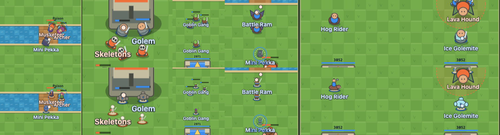

# Battle graphics

Live play and saved HTML replays use `cr_arena/battle_renderer.js` for the arena,
units, names, health bars, projectiles, spells, and animation effects. Change those
graphics there so both views stay consistent. The renderer takes positions and
radii in tiles, with Blue at the bottom; its file header documents the row layout.
Both views supply the arena grid from the simulation or trace, rather than
guessing bridge positions.

The arena now uses layered grass, water, stone banks, and wooden bridge planks.
Bridges and rails follow the simulator's actual water grid. Towers and troops
are original canvas miniatures with team-colored roofs or bases, so replay files
remain self-contained and work offline. The troop silhouettes cover the common
RoyaleGym cards; an unknown card receives a generic armored miniature and its
name label. These are illustrative graphics, not imported Clash Royale assets.
REA 6.9.0 parsed `battle_renderer.js` as a standalone JavaScript source and
found no module imports in that file; it did not evaluate the artwork. The
graphics were then checked in a browser against a recorded replay. REA is an
analysis tool and is not needed at runtime.


The [Arena 1 gameplay video](https://www.youtube.com/watch?v=PD6QCK7GzA8)
is saved locally at `data/references/arena-1-PD6QCK7GzA8.mp4` for a future
reference-matching pass; see [data documentation](../data/README.md#visual-reference).

## Classic-deck ground troops

The ground troops of the seven classic decks (Archer, Battle Ram, Electro Wizard,
Giant, Goblin Gang, Golem, Hog Rider, Ice Golem, Ice Spirits, Knight, Mini P.E.K.K.A,
Musketeer, P.E.K.K.A, Princess, Skeletons and Wizard) and the units they spawn in
classic-deck traces (Golemites, Barbarians, stab Goblins, Spear Goblins and
individual Skeletons) use upright three-quarter miniatures. Team colour is on
each base and on a cape, tabard, sash or belt. A troop no longer spins with its
facing. It mirrors when moving left on screen and shows its back when walking up
the screen. The pose uses the same screen-space facing as before, so board
flipping still applies. Entity position, interpolation, radius, health bars and
hit targets are unchanged. Flying troops, buildings, towers, spells and every other card
keep their earlier drawing.



A spawned unit keeps its card's ID: a Golemite reports the Golem card, a Barbarian
the Battle Ram, and a Spear Goblin Goblin Gang. Entity rows therefore carry an
optional 19th field, `unitType`, holding the engine's unit-type name
(`Engine.unit_types()` live; `TraceHeader.unit_types` in replays). The renderer
uses it only for the cards above, so Tombstone and Goblin Barrel units are
unchanged. Traces without unit types fall back to the card, with units narrower
than 0.62 tiles drawn as Golemites or Barbarians.

REA 6.9.0 (`analyze-javascript-application`, then `trace-application-feature`
and `trace-javascript-semantics`) traced the path before the change. `drawTroop` had one caller,
`drawEntity`, whose `facing` argument came from `facingX/facingY` after the
flip transform. Card identity came from the `cards` binding set in `draw` and
read as `cards[cid][0]`, then classified by regular expressions. That is why
Golemites drew as Golem-coloured humans and Barbarians as Battle Ram tokens.
On macOS 27, REA's process helper builds only with an older SDK:
`SDKROOT=/Library/Developer/CommandLineTools/SDKs/MacOSX26.5.sdk`.

Visual references: the local Arena 1 video at 1:16, 3:00 and 3:36 shows upright
P.E.K.K.A, Archers with team-coloured capes and level badges, and units that turn
by mirroring. Troops absent from that video were checked against their card pages
on the [Clash Royale Wiki](https://clashroyale.fandom.com/wiki/Cards):
[Giant](https://clashroyale.fandom.com/wiki/Giant),
[Hog Rider](https://clashroyale.fandom.com/wiki/Hog_Rider),
[Golem](https://clashroyale.fandom.com/wiki/Golem),
[Ice Golem](https://clashroyale.fandom.com/wiki/Ice_Golem),
[Ice Spirit](https://clashroyale.fandom.com/wiki/Ice_Spirit),
[Electro Wizard](https://clashroyale.fandom.com/wiki/Electro_Wizard),
[Wizard](https://clashroyale.fandom.com/wiki/Wizard),
[Princess](https://clashroyale.fandom.com/wiki/Princess),
[Battle Ram](https://clashroyale.fandom.com/wiki/Battle_Ram),
[Knight](https://clashroyale.fandom.com/wiki/Knight),
[Musketeer](https://clashroyale.fandom.com/wiki/Musketeer),
[Mini P.E.K.K.A](https://clashroyale.fandom.com/wiki/Mini_P.E.K.K.A),
[Goblin Gang](https://clashroyale.fandom.com/wiki/Goblin_Gang) and
[Skeletons](https://clashroyale.fandom.com/wiki/Skeletons). The miniatures keep
only identifying traits, such as hair colour, headgear and weapon. They remain original canvas
drawings.

`live.html` handles the WebSocket stream, HUD, and placement controls. `replay.html`
adapts RoyaleGym's named trace columns into the same drawing contract and handles
playback, scrubbing, flipping, and tooltips. Its playback controls were adapted
from RoyaleGym under the MIT license in `third_party/RoyaleGym-LICENSE.txt`.
`replay.py` continues using RoyaleGym to validate and prepare traces, but no longer
patches upstream JavaScript strings.

`rendering.embed_renderer` embeds the shared JavaScript in both pages. Generated
replays remain single HTML files that work offline. Existing generated HTML files
need to be re-rendered to pick up graphics changes:

```sh
uv run python -m cr_arena.replay path/to/battle.msgpack -o battle.html
uv run python -m unittest discover -s tests
node --test tests/battle_renderer.test.cjs
```

Live input previews and replay deploy annotations are view-specific overlays.
Live placement masks use RoyaleGym's `PlacementOracle` at half-tile resolution,
independent of elixir and the opening lockout. Each mask carries its dimensions,
resolution, and card ID. The same half-cell defines its shading and the centre
sent on a click, and stale masks for a different card are ignored. Spatially
eligible cells can still require more elixir or waiting before a play is accepted.
Living friendly princess towers exclude their engine-reported placement footprints
for troop and building drops; spells can still target them. Their shared graphics
use those same footprints, and destroyed towers release the occupied area. King
towers retain their arena-defined exclusion block.
Replay interpolation is a straight-line estimate between recorded frames; a
replay cannot recover live events or pending placements absent from its trace.
