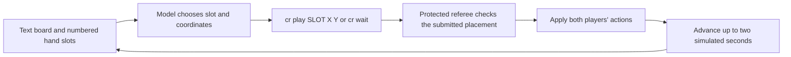

# RoyaleBench v3

**RoyaleBench v3** is the 11-case coordinate foundation: all **11 released continuation scenarios** use
direct coordinate actions against Planner. The source is
[`benchmarks/royalebench-v3`](../benchmarks/royalebench-v3), benchmark version `3.0.0`.
The stable action protocol is named `coordinates-v1`; that protocol version is separate from
the benchmark release and Valkyrie's immutable dataset revision (`@1`, `@2`, ...).
The current published revision is **`royalebench/royalebench-v3@2`**, tagged `v3-support`.
The initial `@1` revision remains available under tag `v3` for historical runs.

## Support carried forward from v1

Revision `@2` carries the operational additions made across the v1 releases:

| v1 release | Support in v3 |
| --- | --- |
| `@2` | Private observation/action/state/event capture, carried replay checkpoints, instruction and resource provenance, and the same separate verifier and artifact layout. Coordinate attempt acceptance and rejection remain explicit. |
| `@3`–`@6` | The same agent network allowlist for Anthropic, OpenAI, OpenRouter, and the Modal Qwen, Inkling, DeepSeek and Kimi endpoints. The verifier still requests no network. The existing dashboard model presets and billing view work with v3 runs. |
| Subsequent observation update | Compact `Opponent plays: Card@(x,y), ...` text in the coordinate board view, with the full engine state and action history retained in private capture. |

The builder takes scenario inputs from the pinned v1 `@1` source snapshot in
[`data/royalebench-v1-source`](../data/royalebench-v1-source), while current runtime code supplies
the observation and capture behavior. Every packaged task records its own protocol hash, task ID,
instruction hash, rubric, capture schema and resource limits. The changed task bytes were
published as `@2`; existing `v3@1` runs remain attributed to `@1`.

V3 promotes the coordinate harness tested in the [historical three-task pilot](coordinate_harness.md)
to the full released task set. It preserves the exact v1 decks, seeds, tower HP, starting hands,
unit positions, match phases, objectives, cadence and Planner settings. Frozen v1 and pilot
task files remain unchanged. The three configurations from gated families 11 and 12 remain
under `candidates/` without `task.toml`; they are not runnable or scored.

## Default player flow

The [Tactics extension](tactics.md) also uses this coordinate foundation, sharing its runtime,
deployment handling, telemetry and endpoint policy while calibrating separate strategic scenarios.



Run `cr` to observe; use `cr play SLOT X Y` to deploy hand slot **0–3**, or `cr wait`.
Coordinates are own-frame tiles: `0 <= x < 18`, `0 <= y < 32`. There are no prepared target
choices, placement suggestions, or automatic placement snapping. The game pauses during
thinking. A well-formed illegal deployment consumes its interval as a wait; malformed command
syntax does not advance time. Card availability and explicit decision-count restrictions apply.
Spending/lane budgets are scored after play, so an accepted but excessive expenditure can fail
the objective. The [coordinate protocol guide](coordinate_harness.md#player-flow) specifies
logging, rejection, timing and replay in full.

Planner continues to generate and search its own coordinate candidates. It sees full engine
state, including hidden hand/elixir information; the model receives ordinary player information.
Both choose from the same frozen state, with a two-second decision cadence and zero command delay.
The model is instructed to submit its own decisions, without scripts or loops choosing/submitting plays.

## Tasks and scores

The [original task table](royalebench_v1.md#tasks-and-grading) gives unchanged objectives and
matchups. The runnable tasks cover lethal, efficient defense, spell placement, tank/support,
successive threats, unequal threats, counterpush, cycling, two tower races, and protecting a lead.

Rewards are binary and require completed play and replay integrity. Report the mean over the
11 variants, per-family means (tower race has two variants), and the lethal control separately.
CSV archetype rates and privileged reference successes are not model benchmark scores.

V3 references are translated from the actual protected v1 action traces, including the exact
coordinates stored there. The builder inserts explicit waits where the historical menu forced
them, verifies each coordinate reference twice, and requires wait/empty/malformed controls to
score zero before packaging. Each task's evidence pins configuration, protocol and reference-log
hashes. Matching cached calibration is reused only after another reference replay; stale evidence
is recalibrated. Isolated calibration processes may work on disjoint task directories, and only
the parent writes the dataset manifest.

See [`manifest.json`](../benchmarks/royalebench-v3/manifest.json) and
[`runs/royalebench-v3`](../runs/royalebench-v3) for actual release/validation evidence.
All **11/11 references** pass local calibration and actual CLI/socket validation in Docker,
including player isolation, restart persistence, and fresh-container grading with no network.
Every replay reproduces its frame hashes. The initial `@1` release checks passed **185 Python tests plus
13 subtests**, **208 web tests**, API type generation, typechecking, lint, and a production build.
Web checks used Node **20.20.2**; validation commands and provenance are recorded in
[`checks.json`](../runs/royalebench-v3/checks.json).
The initial `@1` revision also passed a hosted lethal control with Sonnet 4.6 through
`claude_code-v1.0.0` on Modal: run `5b0afc35-e137-4143-b288-249634c0f181`, reward **1**,
integrity **1**, and zero rejected deployments. Results are retained in
[`model-lethal-results.json`](../runs/royalebench-v3/model-lethal-results.json). This is one
control task, not an eleven-task model score.
For revision `@2`, all 11 references again pass local and isolated Docker validation, including
complete carried capture and frame hash verification. The new validation is in
[`docker-revision2/validation.json`](../runs/royalebench-v3/docker-revision2/validation.json).
The [revision check summary](../runs/royalebench-v3/checks-revision2.json) pins the published
digest, protocol hash, Python checks and container checks.
A hosted Qwen/mini-SWE-agent lethal smoke test on `@2` finished with reward 1, integrity 1,
no rejected action, and a direct `cr play 0 3.5 25.5` deployment. Its carried capture is complete
and its archive verifies; see [pilot evidence](../runs/royalebench-v3/qwen-support-pilot.json).
This is one task, not a cohort score. The current collector does not extract individual model
calls from this stock harness, though its raw trajectory is retained in the archive.
Full-cohort frontier-model scores now include one paired `@2` run each with
`claude_code-v1.0.0` on Modal: Claude Opus 5.5 scored **11/11** and Claude Sonnet 5.5
scored **7/11**, both with integrity 1. These are one attempt per task, not repeated
estimates. The [v4 challenge guide](royalebench_v4.md) records task-level results,
trace findings and the corrected `@2` challenge comparison. Historical pilot scores
(coordinates 3/3, menu 2/3 in one Sonnet 4.6 attempt each) remain attributed to
their original dataset revisions; they are not renamed v3 results.

## Build, validate and run

```bash
uv run python -m cr_arena.build_v3 --jobs 2
uv run --with pytest python -m pytest -q tests/test_royalebench_v3.py tests/test_coordinate_task.py tests/test_royale_task.py
uv run python -m cr_arena.validate_v3_docker --jobs 2
```

`--jobs` only parallelizes independent local validation processes/containers. Each Planner still
uses `workers=0`, with no wall-clock search cutoff. Docker validation exercises player isolation,
the actual CLI, restart persistence, and fresh-container grading with networking disabled.
Use `--fresh` with the builder to rerun all negative controls, or `--tasks 1 3` with the Docker
validator for a diagnostic subset. A subset does not prove that the entire dataset passed.

Publish through the existing [Valkyrie/Modal workflow](valkyrie_guide.md):

```bash
valkyrie dataset push royalebench/royalebench-v3 ./benchmarks/royalebench-v3 --tag v3-support
```

Pin the new immutable revision for comparisons:

```bash
valkyrie run start --agent claude_code-v1.0.0 \
  --dataset royalebench/royalebench-v3@2 \
  --model anthropic/claude-sonnet-4-6 --provider modal \
  -s ANTHROPIC_API_KEY "${VALKYRIE_ANTHROPIC_SECRET:?Set your secret name first}" \
  --task-ids 01-immediate-lethal --concurrency 1 --label royalebench-v3-lethal-pilot
```

Start small, inspect the model's decisions and replay, then expand. Record exact revisions,
model/harness settings, resources, run IDs, costs and failure classifications. New runs should
be enrolled in [evidence collection](data_collection.md).
The Qwen, Inkling, DeepSeek and Kimi presets in `evals.toml` can also use `@2` with the
harness and secret mappings documented in their respective Modal guides. Their v1 pilot scores
do not transfer to v3; compare models only after new runs on this exact revision.

The dashboard now selects the curated [v5 dataset](royalebench_v5.md) for new jobs.
Explicit benchmark links and manual selections take precedence. Historical v3 runs
retain their original interface and scores.
